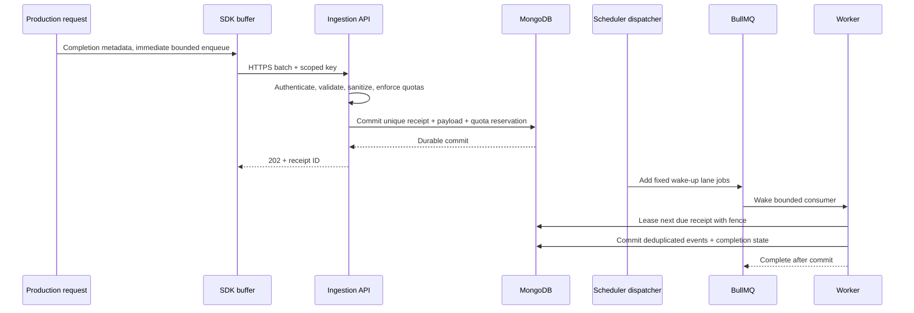

# Data flow and background execution

Status: proposed contracts and pilot defaults. See [security](security.md) for mandatory data and destination policies, [database design](database-design.md) for uniqueness and statistics, and [deployment](deployment.md) for outage behavior.

## 1. SDK integration and request lifecycle

One SDK client per application process, not per request. Initialize once from server-side configuration with project/environment credentials and a fixed HTTPS monitoring origin. Export Express middleware plus an optional safe error observer. The package must not install process-global exception handlers, change response bodies/status/headers, consume request/response streams, wrap arbitrary application methods, or retry application requests.

Register timing middleware before monitored routes. Attach completion listeners immediately and use a monotonic clock for duration. On response `finish`, snapshot allowlisted metadata and attempt a bounded in-memory enqueue; no network or database call is awaited. Handle `close` before `finish` once as an aborted request; guard against double recording. A finish measures server response completion, not client receipt, DNS/network latency or database-specific duration. Streaming requests are measured until completion and reported separately; long-lived connections are not equivalent to normal request latency. [Node.js HTTP event semantics](https://nodejs.org/api/http.html#event-finish_2).

Use configured route templates or safely validated Express route metadata at completion, including nested router templates. Do not reconstruct URLs from actual path values. Unknown/404 routes become `__unmatched__`; untrusted or excessive templates become `__other__`. Initial ceiling: 200 registered route templates per project/environment; methods are a fixed enum. Do not derive labels from user IDs, query strings, IP addresses or arbitrary headers. Express version/router compatibility is a required SDK test matrix.

For request telemetry, `occurredAt` is the response completion/abort wall-clock time, not request start time; duration uses the monotonic clock separately. This allows long requests to be submitted within the admission age limit after they finish. Boot/release labels come only from reviewed server configuration, with capped length and active-instance cardinality.

An optional four-argument error observer sits before the application's existing error handler and calls `next(error)` exactly once after a protected metadata capture. It does not take over error handling. If a handler consumes exceptions before that observer, only status-based failures are visible unless a later approved explicit capture call is integrated. Deduplicate request error capture by event ID. Startup failures and detached asynchronous exceptions are out of initial SDK scope.

### SDK bounds

| Limit | Initial value / behavior |
| --- | --- |
| Buffered events | 1,000 events and 2 MiB estimated encoded bytes, whichever is reached first; includes retries and in-flight data |
| Event size | 8 KiB maximum encoded event; reject oversize locally |
| Batch | Up to 100 events or 256 KiB encoded JSON, whichever first |
| Flush | Every 5 seconds with jitter, or batch threshold; one in-flight request per process |
| Submission timeout | 3 seconds total including connection/DNS; no overlapping flush timers |
| Retry | At most 5 attempts total, exponential jitter, bounded by 10-minute event age; bounded `Retry-After` respected |
| Overflow | Drop oldest buffered, non-in-flight event; if space cannot be reclaimed, drop new event; never grow past cap |
| Persistent disk spool | None initially; process exit can lose buffered data |
| Shutdown | Explicit application shutdown hook may flush for at most 2 seconds; never delays an API response |

Transient DNS/network failures, 408, 429 and 5xx may retry. Permanent validation/authorization errors do not loop: count drops, log a rate-limited safe diagnostic and disable sending on revoked/invalid credentials until configuration changes. Retry uses the same batch ID, immutable body and event IDs. Retry exhaustion opens a short circuit with jittered recovery probes. Timers are unreferenced where supported; no global unbounded request buffer or offline HTTP queue.

Collect bounded aggregate counters independently of individual event sampling: observed completions, aborts, selected events, local drops by reason, retries and last successful send. Send a small heartbeat every 30 seconds through the same bounded transport. A process boot ID plus monotonically increasing heartbeat sequence makes cumulative counter updates idempotent; process crashes can still lose the last interval. No claimed global traffic total if coverage is incomplete. SDK disablement must be possible by environment configuration without calling the monitoring platform.

## 2. Secure durable ingestion

Proposed endpoint: `POST /api/v1/ingestion/batches`. Proxy and application limits apply to uncompressed JSON; do not enable compressed submissions initially. Bound body parsing, header size, connections, request lifetime and parser concurrency. Extract the credential before expensive event validation where possible; any parsed bytes remain under a strict limit.

Authenticate key against MongoDB, bind project/environment from its record, and reject a conflicting submitted scope. Apply IP, credential and project quotas. Validate the entire batch with strict Zod schemas: supported schema version, UUID-like IDs, capped string/array depth, permitted labels, finite nonnegative durations up to the configured supported maximum, and event timestamps. Reject events older than 10 minutes or more than 2 minutes in the future at admission; preserve server `receivedAt` separately. Clocks outside tolerance produce a visible diagnostic, not rewritten historical truth.

Sanitize into a newly constructed allowlisted object before storing in MongoDB, Redis, logs or responses. Do not log validation bodies. Reject the entire malformed batch with 400/422; no ambiguous partial acceptance. Return 413 for size, 401 for invalid/revoked key, 403 for scope mismatch, 429 for quota/backlog pressure and 503 for unavailable durable storage. Include safe error codes and bounded retry hints.

Reserve pending receipt count and bytes in the same MongoDB transaction as receipt creation. Initial global pending inbox budget: 2,000 receipts or 128 MiB encoded payload, whichever first, with per-project shares so one backend cannot consume all capacity. Serialize a global budget document update with a conditional limit check; never rely on a read-count-then-insert race. Reserve actual canonical encoded bytes plus measured BSON/index headroom when sizing disk.

Uniqueness is `(projectId, environmentId, batchId)`. Store a canonical sanitized payload hash; a duplicate ID with a different hash is a 409 conflict. After authentication and bounded structural validation, resolve existing receipts before applying new-event age or quota checks. A matching duplicate returns the existing acceptance state without consuming new quota; an explicitly expired receipt returns 410 with a safe loss reason, not renewed acceptance. A timed-out commit is ambiguous: resolve by the same ID or let the SDK retry it; never manufacture a new batch ID. `202` means MongoDB acceptance, not Redis publication, processing completion or guaranteed indefinite retention. State expires or fails visibly according to the finite backlog policy below.

## 3. Dispatcher, BullMQ and workers

MongoDB is authoritative for pending work and retries. BullMQ carries only fixed wake-up lane jobs, not one job per receipt. Every five seconds the scheduler attempts to add the documented lane IDs. Existing IDs coalesce; completed/failed wake jobs are immediately removed. No repeatable-job API, custom Redis permit ledger or inspection of BullMQ private keys is needed. Workers lease one due MongoDB record per wake job with a 30-second lease and monotonically increasing fence. Durable effects require the same fence and an unexpired lease. See the full recovery algorithm in [implementation contracts](implementation-contracts.md#queue-and-recovery-contract).

| Queue | Fixed job IDs | Worker concurrency / maximum live jobs |
| --- | --- | --- |
| `ingestion` | `ingest-0`, `ingest-1` | 2 / 2 |
| `health-checks` | `probe-0` through `probe-3` | 4 / 4 |
| `maintenance` | `aggregate-0`, `evaluate-0` | 1 shared / 2 |
| `notifications` | `notify-0` | 1 / 1 |

Nine live job identities bound queue cardinality independent of telemetry volume. Logs and queue event streams are separately capped. Wake jobs have one BullMQ attempt; durable records own business attempt counts, deadlines and backoff. Stalled wake jobs may execute again; database leases/fences still govern effects. Recovery recreates missing wake jobs and reclaims expired MongoDB leases; it never assumes a previously completed BullMQ ID remains deduplicated. Worker failure before marking a durable record leaves it reclaimable; failure after commit is harmless. No recursive self-enqueue or unbounded drain loop; throughput is initially at most two receipts per five-second tick and must be measured. A later shorter tick or additional fixed lanes requires a capacity review.

Use Redis `noeviction`, AOF every second and explicit memory headroom. Pause dispatch at 70% of its measured budget; no telemetry payloads enter Redis. Wake jobs carry only version/kind/lane. Preserve diagnostics in MongoDB, not failed-job payloads. [BullMQ job identity](https://docs.bullmq.io/guide/jobs/job-ids) lasts only while the job exists; [removal](https://docs.bullmq.io/guide/queues/auto-removal-of-jobs) permits reuse of a fixed lane ID.

Business processing is idempotent. For each bounded ingestion receipt, transactionally insert unseen request/error events under unique event keys, update only corresponding new error occurrences, register dirty metric windows, advance heartbeat counters if sequence is newer, and mark receipt processed/release inbox budget. On any failure the transaction aborts. Replays skip existing event IDs; duplicate IDs with conflicting contents are quarantined rather than silently changed. MongoDB transaction size/time must remain bounded by the batch limits. Never increment rollup counts outside a replay-safe transaction.

Transient job failures: up to 5 total attempts with exponential jitter; distinguish dependency unavailability from malformed jobs. Open dependency circuits and pause affected pools during sustained outages so all jobs do not burn through retries immediately. Validation/schema failures go directly to a finite quarantine with safe reason codes. A terminal business failure leaves a durable receipt failed with an explicit operator-replay action; it does not auto-loop forever. Use bounded replay pages and attempt budgets. [BullMQ idempotent job design](https://docs.bullmq.io/patterns/idempotent-jobs).

Pending inbox payloads may wait at most 24 hours. At that age a maintenance service explicitly transitions them to `expired`, counts lost events, releases reservations and removes payloads. Do not silently TTL-delete pending work. Completed payloads are removed promptly; compact receipts remain 48 hours for deduplication. Preserve original receipt time and expiration on replay. Raw event deduplication retention exceeds all admission/replay windows. Redis loss is recovered by recreating wake jobs and leasing MongoDB pending/leased receipts, check runs and outbox records; no attempt is made to recreate already completed work from queue history.

## 4. Independent health-check scheduler

The dedicated scheduler starts and runs without frontend visits, ingestion or API traffic. MongoDB stores monitor configuration, next due time, maintenance state and scheduler heartbeats. A bounded timer loop atomically claims due monitors, creates one durable run for `(monitorId, scheduledFor)`, and advances the next due slot. Use lease/fencing checks for restart or accidental double scheduler instances. Probe wake jobs lease due durable runs through the dedicated queue.

Initial probe interval 60 seconds with stable jitter; minimum allowed 30 seconds. One in-flight probe per monitor, DNS/connect/TLS/read/total deadline of 5 seconds, response body read cap 16 KiB, then discard; expected status policy initially 200–299. Use GET against an existing explicitly approved read-only endpoint, no automatic fallback methods, no redirects, no arbitrary headers/credentials. Optional expected content checks require a separately reviewed safe schema; initial checks use status/latency only.

Retries of queue infrastructure are not new availability observations. Do not perform immediate repeated HTTP probes and count them as independent failures. Persist a check result once per scheduled slot; a crashed, partially executed probe may be repeated but can only contribute one result. Runs started more than one interval late become `missed`; do not execute a backlog of stale probes or create synthetic failures. After downtime create only the current due run and record the missing interval. Scheduler delay is reported separately from probe latency.

Probe outcomes: healthy, target HTTP failure, transport/TLS/DNS failure, blocked destination, monitor-infrastructure failure, or missed. Only trustworthy target observations contribute to target down rules; a DNS failure from this VM is a reachability observation, not proof of global outage. Redis/MongoDB/platform failure yields stale/unknown monitoring. Maintenance suppresses notifications and preserves observations. An external watchdog is still required: an in-VM scheduler cannot observe its own VM being off.

## 5. Alert evaluation and incidents

Evaluation runs once per minute against finalized metric windows and recent check results, independently of user requests. MVP rules: consecutive probe failures, finalized high 5xx ratio and high p95. Missing SDK heartbeats and platform backlog/freshness are operational unknown/stale signals; external watchdog delivery remains independent. Fast health evaluation uses new check slots without waiting for the telemetry watermark. Define project/environment scope, route filter, threshold, minimum samples, window, breach count, recovery threshold/count, cooldown and maintenance policy in each versioned rule.

Example policies: open availability incident after three consecutive scheduled target failures and resolve after two successful probes; open a 5xx incident when ratio exceeds 5% with at least 100 completed requests over five minutes for two consecutive evaluations; recover below 2% for two evaluations. These are tuning examples, not universal defaults. Windows with no traffic or deficient coverage are `insufficient_data`; latency rules must handle histogram uncertainty as described in database design. An acknowledgement never resolves an active breach.

Lifecycle: `pending` breach tracking → `open` → `acknowledged` (still active) → `resolved`. A later breach creates a new incident linked to its predecessor. Rule disablement, deletion or monitor removal resolves an active incident with an explicit administrative reason, distinct from observed recovery. Maintenance suppresses opening/delivery and records suppression; on exit require fresh observations. Unknown data neither recovers nor opens a target outage; retain the active incident with stale evidence and separately report monitoring failure.

Use one active incident per `(ruleId, scopeKey)` enforced by a partial unique index. Serialize evaluations using rule-state version checks and unique evaluation window IDs; retries or multiple workers cannot advance breach counters twice. Older/out-of-order evaluations cannot regress state. Freeze the evaluated rule version and evidence in history. Delayed telemetry can revise charts but does not send retroactive pages for old windows; history records corrections.

Commit incident transition, timeline event, rule state and notification outbox entry together in MongoDB. Stable notification identity is `(incidentId, transitionVersion, channel, reminderSlot)`. A durable outbox dispatcher recovers enqueue gaps. Initial cooldown is 15 minutes between optional reminders; reminders are deferred, and opening/recovery each send once. Repeated breach evaluations never send another opening email. The worker sends a minimal Resend email with that identity as provider idempotency key, stores provider ID, and retries bounded transient errors. Treat delivery as potentially duplicated outside the provider's idempotency window; do not claim exactly-once email. Stop automatic ambiguous retries before 24 hours and require reconciliation. A successful API send means provider accepted, not inbox delivery. [Resend idempotency keys](https://resend.com/docs/dashboard/emails/idempotency-keys).

## 6. Socket.IO and frontend reads

Host Socket.IO in the API process behind the VM TLS proxy. Worker services publish small Redis pub/sub invalidations after database commit: `metrics.updated`, `incident.changed`, `check.updated`, `platform.status`. Envelope: version, event ID, project/environment, entity ID, entity revision and server timestamp. No raw stack, key, payload, user identity or per-request event firehose.

Authenticate the handshake with a short-lived admin access JWT in the Socket.IO auth object, not a URL. Verify session in MongoDB and authorized project membership before server-controlled room assignment. Initially all projects belong to the one private administrator; there are still no client-chosen room names. Enforce origin, payload, event rate and connection-count limits. Close sockets at token expiry, revoke/disconnect on logout, and recheck sessions periodically; losing session storage fails closed.

Coalesce metric invalidations to at most one per project/environment per second; slow clients lose invalidations instead of accumulating buffers. TanStack Query invalidates affected REST queries, refetches on reconnect/focus, and polls every 30 seconds as a fallback. Entity revisions discard stale duplicates. On any reconnect or missed freshness deadline obtain a REST snapshot; REST returns data `asOf`, `completeThrough`, quality and revision metadata. Avoid a persistent socket replay log initially. Socket.IO defaults to at-most-once arrival; pub/sub does not guarantee recovery. [Socket.IO delivery guarantees](https://socket.io/docs/v4/delivery-guarantees/).
