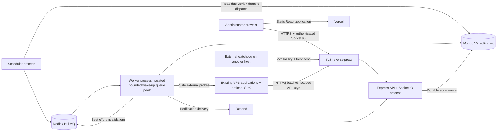

# Private API Intelligence & Monitoring Platform

Status: Phase 1 - Step 2 refined architecture, 2026-11-21. Documentation only; no implementation or deployment is authorized by this document.

## Scope and assumptions

Monitor 5–6 existing Node.js/Express/Mongoose production applications on separate VPS servers. One private installation, one initial administrator, multiple monitored projects and environments. Projects represent applications, not tenants. No billing, subscriptions, public registration, customer isolation framework, Kubernetes, or independently deployed business microservices.

Step 1 produced seven architecture documents. Step 2 refines them and adds implementation-contracts.md; no application code or deployment is included.

Existing production backends remain untouched in this step. Request telemetry eventually requires an explicitly approved package installation and middleware registration in each application. Zero application changes can provide external availability checks, but cannot provide internal Express route timings or exception context. Start with existing safe health endpoints; do not create or alter production endpoints here.

Traffic, route count, hardware, existing health endpoints, Express versions, domains, network access and acceptable loss are unknown. Numerical limits below are proposed pilot defaults, not measured capacity or guaranteed service levels. Roll out to one staging application before production.

## Architecture

Use a modular monolith: one TypeScript backend codebase, one MongoDB database, one Redis instance, and separately supervised API, worker and scheduler processes. Separation isolates event loops and restarts without introducing distributed business services.

### Component responsibilities

| Component | Owns |
| --- | --- |
| SDK | Minimal request timing and safe error metadata; bounded memory, batching, retry and drop counters; never waits for monitoring on a request |
| Express API | Admin authentication, configuration, API key authorization, bounded ingestion validation and durable acceptance, analytics reads, authenticated sockets |
| MongoDB | Configuration, sessions, durable inbox, deduplicated raw events, aggregates, checks, incidents, notification outbox and audit records |
| Redis / BullMQ | Bounded execution queues, scheduling wakeups, rate limits and transient pub/sub; not the authoritative telemetry store |
| Worker | Ingestion processing, aggregate rebuilds, health probes, alert evaluation and notification delivery through feature services |
| Scheduler | Reconcile durable pending work, create due check runs, schedule evaluation/aggregation and maintenance; independent of HTTP traffic |
| React application | React JavaScript + Vite + Tailwind CSS; React Router DOM, Axios, TanStack Query, Recharts, Socket.IO Client and Lucide React |
| Resend | Email delivery only; receives minimal incident summaries, never raw telemetry or secrets |
| External watchdog | Detect loss of the monitoring VM and stale scheduler/worker heartbeats from a different failure domain |

Backend stack remains Node.js + TypeScript + Express, Mongoose, Zod, JWT + bcrypt, Redis + BullMQ, Socket.IO and Resend. SDK source is TypeScript, published as compiled JavaScript with declarations and tested CommonJS/ES module entry points. No TypeScript requirement is imposed on existing applications or the frontend.

## Core decisions

1. Accept a batch only after its sanitized inbox receipt commits to MongoDB. Return HTTP 202 for durable acceptance, not completed processing. Redis outage alone can be buffered in the finite MongoDB inbox. Trade-off: ingestion needs a database write and a replica-set-capable deployment.
2. Treat delivery as at least once within bounded retry windows. MongoDB uniqueness and idempotent services prevent duplicate counts. No end-to-end exactly-once claim.
3. Preserve production availability ahead of telemetry completeness. SDK overflow or prolonged outages cause counted drops. Monitoring adds bounded CPU/memory overhead; it cannot promise literally zero overhead.
4. Keep independent active probes alongside passive SDK telemetry. Missing traffic is not evidence that an application is down; a failed monitor is not evidence that the target is down.
5. Store short-lived raw events and mergeable latency histograms for longer history. Defer bounded exact queries against retained raw data; label histogram percentiles approximate. Never average percentiles.
6. Emit UI invalidations after durable writes. REST is authoritative; Socket.IO and Redis pub/sub may lose events.
7. Acknowledge the initial VM as a single failure domain. Separate processes improve isolation, not high availability. Free-tier availability is not a deployment guarantee.
8. Develop and deploy without Docker. Development runs Node.js locally against MongoDB Atlas and Redis Cloud; deployment runs independently supervised Node.js processes. See [deployment](deployment.md#docker-free-strategy).

## Documentation map

- [Implementation contracts](implementation-contracts.md): normative field, HTTP, queue, state-machine and acceptance contracts; exact Phase 2 - Step 1 boundary.
- [Data flow](data-flow.md): SDK, ingestion, queue processing, probes, alerts and sockets.
- [Backend modules](backend-modules.md): feature ownership and dependency rules.
- [Database design](database-design.md): collections, indexes, retention and statistical definitions.
- [Security](security.md): data minimization, admin sessions, API keys, boundaries and SSRF.
- [Deployment](deployment.md): processes, network layout, recovery and sizing.
- [Implementation roadmap](implementation-roadmap.md): sequencing, decision summary, risks and exact next-step scope.

## Architecture acceptance criteria

Before broad production rollout, demonstrate bounded SDK memory during a prolonged outage; unchanged response semantics during SDK failures; safe redaction before any transmission; rejection of cross-project credentials; duplicate delivery without inflated analytics; recovery from partial processing and Redis loss; SSRF denial under DNS rebinding and redirects; visible stale/unknown state when collection fails; finite queue/storage growth; and backup restoration. Measured capacity must support observed peak arrival rate plus recovery headroom, not just daily averages.

## MVP simplification and priority

[Implementation contracts](implementation-contracts.md) is the normative Step 2 contract. This set describes one modular monolith, not a distributed service platform.

| Priority | Components |
| --- | --- |
| Mandatory MVP | Single admin, projects/environments/keys, bounded SDK ingestion, raw events, minute histograms, error groups, independent active checks, incidents, email, REST dashboard and minimal Socket.IO invalidations |
| Required production safety | Durable finite inbox/outbox, transactions, uniqueness, leased/fenced work, SSRF-safe probes, revocable sessions, limits, encrypted off-host backups/restore drill, external watchdog, explicit loss/staleness indicators |
| Later | Multiple admins/RBAC, sharding/time-series collections, horizontal API scaling, exact percentile query jobs, hourly/year-long retention, reminder emails, metric sampling/traffic estimation, stack frames, private-network probes, general workflow engine |

Replace per-record queue references and custom Redis permits with a fixed set of wake-up lane jobs; workers lease durable MongoDB work. Queue loss costs latency, not loss of accepted payloads. Replace approximately 710 histogram bins with a versioned 25-bin layout whose error is explicitly returned. Keep transactional replay safety and historical dirty-window rebuilds. The initial MongoDB choice remains open; standalone MongoDB is incompatible. No hosting provider, including Oracle or Vercel, is assumed to guarantee free always-on capacity.
